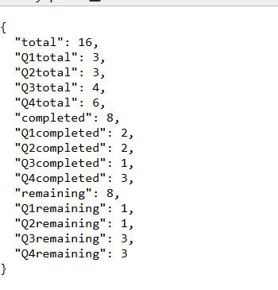

# Tasks API

I made a simple API that acts as a task manager using FastAPI and Python. It allows the ussage of an Eisenhower Matrix in order to organize tasks based on their urgency and importance.

## Installation
In order to install the package you will need to run ```pip install -i https://test.pypi.org/simple/ resolution-week3-Asurant``` in your CLI

## Running The Project
After you install the package you can start the API using:  
```todo-api```  
The API will the run locally at:  
```http://127.0.0.1:8000```  
However you can access the API documentation and use it at:  
```http://127.0.0.1:8000/docs```  

## API Endpoints
| Request | Endpoint | Description |
|---|---|---|
| GET | /tasks | Gets All Tasks |
| GET | /tasks/stats | Gets The Task Statistics (Shown In Below Image) |
| POST | /tasks | Creates A New Task |
| PATCH | /tasks/{task_id}/complete | Marks A Task As Complete Based On ID |
| DELETE | /tasks/{task_id} | Deletes A Task Based On ID |


